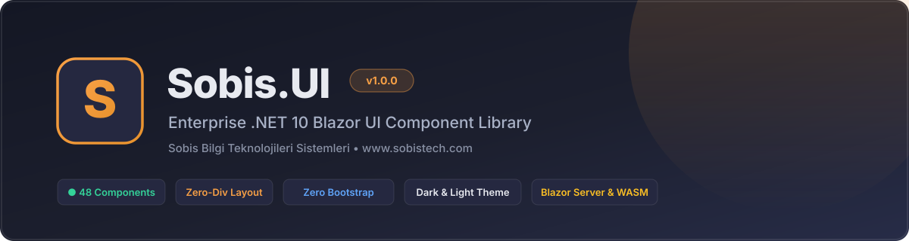

<p align="center">
  <a href="https://www.sobistech.com">
    
  </a>
</p>

<p align="center">
  <a href="https://www.sobistech.com"></a>
  <a href="https://www.nuget.org/packages/Sobis.UI"></a>
  
  <a href="LICENSE"></a>
</p>

<p align="center"><strong>🇹🇷 Türkçe</strong> &nbsp;|&nbsp; <a href="README.en.md"><strong>🇬🇧 English</strong></a></p>

---

**Sobis.UI**, **Sobis Bilgi Teknolojileri Sistemleri** (`www.sobistech.com`) tarafından geliştirilen bağımsız ve kurumsal bir **.NET 10 Blazor UI Bileşen Kütüphanesi**dir. Veri yoğun kurumsal ekranlar için tasarlanan kütüphane; ham `<div>` kalabalığını ve Bootstrap bağımlılığını ortadan kaldıran, saf `--sbs-*` CSS tasarım token'larıyla çalışan **48 adet tür güvenli Razor bileşeni** sunar.

### ✨ Öne Çıkan Özellikler

| Özellik | Açıklama |
|---|---|
| **Sıfır-`div` Yerleşim Sistemi** | `SbsPage`, `SbsToolbar`, `SbsStack`, `SbsGridLayout`, `SbsFormLayout`, `SbsFormGroup`, `SbsField` ve `SbsCard` ile ham `<div>` ve Bootstrap sınıfları olmadan eksiksiz CRUD ekranları oluşturun. |
| **Sıfır Bootstrap Bağımlılığı** | Saf `--sbs-*` CSS tasarım token'ları, kompakt kurumsal **Koyu (Dark)** varsayılan tema ve yüksek kontrastlı **Açık (Light)** (`[data-theme="light"]`) tema desteği. |
| **Çift Modlu `SbsGrid`** | Hem bildirimsel `<SbsGridColumn ... />` hem de liste tabanlı `Columns="_columns"` sütun tanımı, istemci/sunucu sıralama & sayfalama, alt toplamlar (`Count`, `Sum`, `Average`, `Min`, `Max`), satır aksiyonları ve Excel/PDF dışa aktarım. |
| **Türkçe Duyarlı Arama** | `SbsGrid`, `SbsComboBox`, `SbsMultiSelect` ve `SbsTagBox` içinde yerleşik `İ/ı/Ş/ş/Ğ/ğ/Ö/ö/Ü/ü/Ç/ç` uyumlu arama. |
| **Kurumsal Form Bağlamı** | `SbsInputBase<T>` ile `Disabled`, `ReadOnly`, `LabelPosition`, `CascadedRequiredFields`, `CascadedEditableFields` ve Blazor `EditContext` desteği tüm alt alanlara otomatik yayılır. |
| **Esnek Yetki & Çoklu Dil** | `ISbsAuthorizationProvider` ve `ISbsLocalizer` arayüzleriyle uygulamanıza sıfır bağımlılıkla entegre olur — hem **Blazor Server** hem **Blazor WebAssembly** uyumludur. |

---

## 🚀 Hızlı Başlangıç

### 1. Paketi Kurun

```bash
dotnet add package Sobis.UI
```

### 2. Servisleri Kaydedin (`Program.cs`)

```csharp
using Sobis.UI;

// Opsiyonel: Kendi yetki ve çoklu dil adaptörlerinizi ekleyin
builder.Services.AddScoped<ISbsAuthorizationProvider, MyAuthProvider>();
builder.Services.AddScoped<ISbsLocalizer, MyLocalizer>();

builder.Services.AddSbsUI(options =>
{
    options.DefaultToastPosition = SbsToastPosition.TopRight;
    options.DefaultToastShowCloseButton = true;
    options.DefaultTheme = "dark"; // "dark" veya "light"
});
```

### 3. CSS & JS Dosyalarını Ekleyin (`App.razor` veya `wwwroot/index.html`)

```html
<!-- <head> içine -->
<link rel="stylesheet" href="_content/Sobis.UI/css/sobis-ui.css" />
<link rel="stylesheet" href="YourApp.styles.css" />

<!-- </body> kapanışından önce -->
<script src="_content/Sobis.UI/js/sobis-ui.js"></script>
```

### 4. Namespace & Global Host Bileşenleri

```razor
@* _Imports.razor *@
@using Sobis.UI

@* MainLayout.razor *@
<SbsToastContainer />
<SbsConfirmDialog />
<SbsDialogProvider />
```

### 5. Sıfır-`div` Kurumsal CRUD Ekranı Örneği

```razor
<SbsPage Busy="LocalBusy" RequiredFields="ZorunluAlanlar">
    <SbsToolbar>
        <SbsButton Text="Sorgula (F8)" Icon="fa fa-search" Variant="primary" OnClick="OnSearchAsync" />
        <SbsToolbarDivider />
        <SbsButton Text="Yeni (F2)" Icon="fa fa-file" Variant="ghost" ClaimCode="Birim.Create" OnClick="OnNewAsync" />
        <SbsButton Text="Kaydet (F3)" Icon="fa fa-save" Variant="save" ClaimCode="Birim.Create,Birim.Update" OnClick="OnSaveAsync" />
    </SbsToolbar>

    <SbsGridLayout Columns="1fr 2fr" Gap="SbsSpacing.Sm">
        <SbsFormGroup Caption="Arama Kriterleri" Icon="fa fa-search">
            <SbsField Label="Birim Adı">
                <SbsTextBox @bind-Value="Search.Filter" Immediate="true" />
            </SbsField>
        </SbsFormGroup>

        <SbsFormGroup Caption="Birim Bilgisi" Icon="fa fa-list" Disabled="@(!FormEnabled)">
            <SbsField Label="Birim Adı" Required="true">
                <SbsTextBox @bind-Value="FormData.Ad" />
            </SbsField>
        </SbsFormGroup>
    </SbsGridLayout>

    <SbsGrid TItem="BirimDto" Data="@GridData" FillHeight="true" PageSize="50"
             ShowEditAction="true" ShowDeleteAction="true"
             OnEditClick="OnEditRowAsync" OnDeleteClick="OnDeleteRowAsync">
        <SbsGridColumn TItem="BirimDto" Field="@nameof(BirimDto.BirimKod)" Caption="Kod" Width="110px" />
        <SbsGridColumn TItem="BirimDto" Field="@nameof(BirimDto.Ad)" Caption="Birim Adı" />
    </SbsGrid>
</SbsPage>
```

---

## 📦 Bileşen Kataloğu (48 Bileşen)

| Kategori | Bileşenler |
|---|---|
| **Yerleşim (12)** | `SbsPage`, `SbsToolbar`, `SbsToolbarDivider`, `SbsSpacer`, `SbsStack`, `SbsGridLayout`, `SbsGridItem`, `SbsFormLayout`, `SbsFormGroup`, `SbsField`, `SbsCard`, `SbsDivider` |
| **Giriş Kontrolleri (12)** | `SbsTextBox`, `SbsTextArea`, `SbsNumberBox`, `SbsPhoneBox`, `SbsDateBox`, `SbsComboBox`, `SbsMultiSelect`, `SbsTagBox`, `SbsCheckBox`, `SbsSwitch`, `SbsRadioGroup`, `SbsFileUpload` |
| **Veri & Aksiyon (3)** | `SbsGrid`, `SbsGridColumn`, `SbsButton` |
| **Navigasyon (5)** | `SbsTabs`, `SbsTabPanel`, `SbsAccordion`, `SbsExpansionPanel`, `SbsDrawer` |
| **Pencereler (6)** | `SbsModal`, `SbsConfirmDialog`, `SbsDialogProvider`, `SbsContextMenu`, `SbsContextMenuItem`, `SbsContextMenuDivider` |
| **Görünüm & Bildirim (10)** | `SbsText`, `SbsAlert`, `SbsBadge`, `SbsChip`, `SbsIcon`, `SbsTooltip`, `SbsEmptyState`, `SbsProgress`, `SbsSkeleton`, `SbsLoading`, `SbsToastContainer` |

---

## 🎨 Tema & Özelleştirme (Koyu / Açık)

Sayfa yenilemeden anlık tema geçişi:

```js
window.sobisUI.theme.set('light'); // veya 'dark'
window.sobisUI.theme.toggle();
```

CSS değişkenleriyle marka renklerini özelleştirme:

```css
:root {
    --sbs-accent: #F8A045;
    --sbs-accent-2: #e8922d;
}
```

---

## 🌐 Canlı Demo & Dokümantasyon

Tüm bileşenleri canlı önizleme, kaynak kodu ve API parametre tablolarıyla **[https://www.sobistech.com](https://www.sobistech.com)** adresinden inceleyebilirsiniz.

## 🧪 Derleme & Test

```bash
dotnet build Sobis.UI.slnx -c Release
dotnet run --project tests/Sobis.UI.Tests/Sobis.UI.Tests.csproj -c Release
dotnet pack src/Sobis.UI/Sobis.UI.csproj -c Release -o artifacts/nuget
```

## 📄 Lisans

[MIT Lisansı](LICENSE) ile lisanslanmıştır. **Sobis Bilgi Teknolojileri Sistemleri** tarafından geliştirilmiştir.